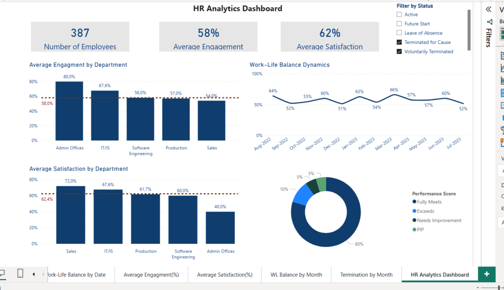

# HR Analytics Dashboard (Power BI)

A four-page Power BI dashboard built on a sample HR dataset. It shows employee engagement, satisfaction, work-life balance and termination trends across departments.

## Pages

- **HR Analytics Dashboard:** KPI cards (number of employees, average engagement, average satisfaction), engagement and satisfaction by department, work-life balance dynamics, performance score distribution.
- **Average Engagement (%)** and **Average Satisfaction (%)**: department comparison against the company average.
- **Work-Life Balance by Date** and **WL Balance by Month**: monthly trend.
- **Termination by Month**: turnover over time.

## Features

- Filter by employee status: Active, Future Start, Leave of Absence, Terminated for Cause, Voluntarily Terminated.
- Reference line for the average value on department charts.

## Data

Sample HR data used for training purposes. No personal or real company data is included.

## How to open

1. Install Power BI Desktop (free).
2. Open `HR_Analytics_Dashboard.pbix`.
3. If the data does not refresh, check the source path in **Transform data**.
